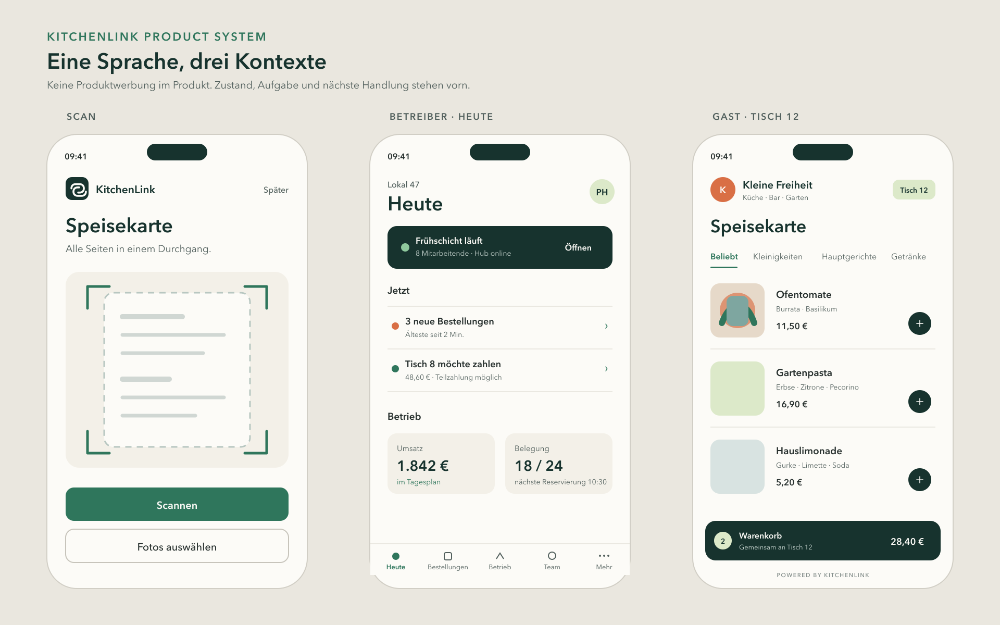
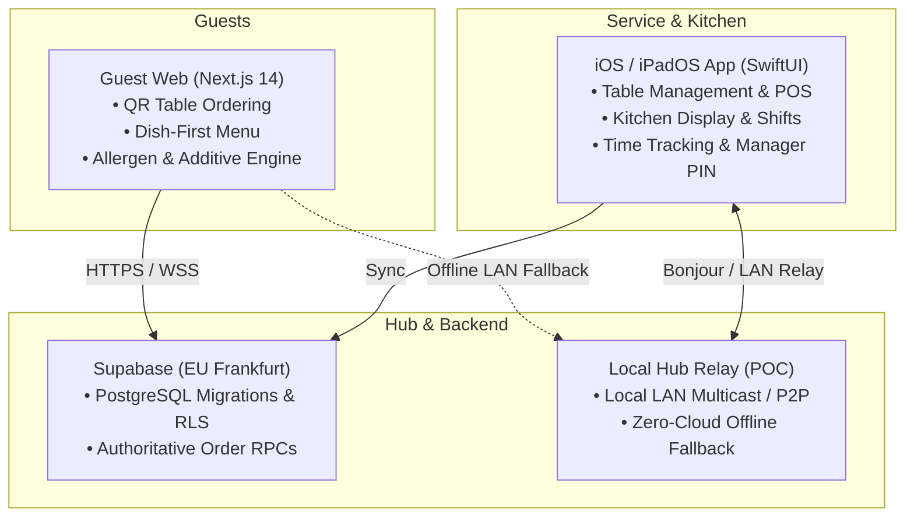

<p align="center">
  
</p>

<p align="center">
  <strong>Smartphone-First Restaurant Operating System</strong><br>
  Native SwiftUI POS • Instant QR Table Ordering • Offline LAN Relay • Supabase Backend
</p>

<p align="center">
  <a href="https://kitchenlink.luneq.eu/alte-muehle/menu"><strong>🚀 Live Guest Sandbox Demo</strong></a>
</p>

<p align="center">
  <a href="LICENSE"></a>
  <a href="https://nextjs.org/"></a>
  <a href="https://developer.apple.com/xcode/swiftui/"></a>
  <a href="https://supabase.com"></a>
  <a href="https://github.com/boethius68/KitchenLink/issues?q=is%3Aissue+is%3Aopen+label%3A%22good+first+issue%22"></a>
</p>

---

<p align="center">
  
</p>

---

**KitchenLink** is a modern, smartphone-first operating system designed for restaurants, bars, and cafes. It bridges the gap between guests, service staff, and the kitchen with a native iOS/iPadOS business app, instant QR-code guest ordering in the browser, and offline-resilient local order dispatching.

> 🇩🇪 **Hinweis für die DACH-Gastronomie:**  
> KitchenLink wurde gezielt für den europäischen Markt entwickelt — mit lückenloser Auszeichnung aller 14 EU-Allergene, deklarationspflichtiger Zusatzstoffe und robuster Offline-Fähigkeit bei instabilem Restaurant-WLAN.

---

## Architecture Overview



---

## Key Features

- 📱 **Native Business App (`kitchenlink/`)**: Built in SwiftUI for iPhone and iPad. Covers floor plans, table ordering, kitchen dispatch screens, cash closing, staff time-tracking, and manager PIN authorizations.
- 🌐 **Dish-First Guest Web (`guest-web/`)**: Next.js 14 web app for instant guest ordering via table QR codes. Features quiet inline allergen pictograms covering all 14 EU allergens and statutory food additives without visual clutter.
- ⚡ **Offline-First Resilience**: If the internet or cloud connection drops, KitchenLink can fall back to local LAN order dispatching so service never halts during rush hours.
- 🗄️ **Authoritative State & RPCs (`supabase/`)**: Strict calculation of order options, portions, deltas, and allowances on the database layer with Row Level Security (RLS).
- 📖 **Comprehensive Documentation (`docs/`)**: Extensive product blueprints, architecture records, and design audits.

---

## Repository Structure

```
├── guest-web/             # Next.js 14 guest ordering web application
├── kitchenlink/           # Native SwiftUI iOS & iPadOS application
├── kitchenlink.xcodeproj  # Xcode project configuration
├── supabase/              # PostgreSQL schema, migrations, and seeds
├── prototypes/            # Standalone Swift packages (Local Guest POC, EventLog)
├── scripts/               # Menu extraction, test runners, quality gates
└── docs/                  # Architecture, product blueprint, and decision log
```

---

## Quick Start

### 1. Guest Web (Next.js)

```bash
cd guest-web
npm install
cp .env.example .env.local
npm run dev
```

Open [http://localhost:3000/alte-muehle/menu](http://localhost:3000/alte-muehle/menu) to view the sample restaurant menu.

To run the automated verification suite:
```bash
npm run typecheck
npm run lint
npm test
npm run build
```

### 2. iOS Business App (SwiftUI)

1. Open `kitchenlink.xcodeproj` in Xcode (Xcode 15+ required).
2. Select the `kitchenlink` scheme.
3. Choose an iOS Simulator (e.g., iPhone 15 Pro or iPad).
4. Build and run (<kbd>Cmd</kbd> + <kbd>R</kbd>).
5. Run unit tests (<kbd>Cmd</kbd> + <kbd>U</kbd>).

### 3. Backend (Supabase)

Local migrations are managed via the Supabase CLI in `supabase/migrations/`. Detailed configuration instructions are documented in [`docs/architecture/guest-web/SANDBOX_SETUP.md`](docs/architecture/guest-web/SANDBOX_SETUP.md).

---

## Roadmap & Blueprints

KitchenLink is being built towards an autonomous, reliable restaurant OS. Canonical product specs, milestone goals, and design guidelines are maintained in the repository:

- [`docs/PRODUCT_BLUEPRINT.md`](docs/PRODUCT_BLUEPRINT.md) — Product scope, milestones, and requirements
- [`docs/collaboration/DECISIONS.md`](docs/collaboration/DECISIONS.md) — Architectural and design decision record
- [`docs/collaboration/CURRENT.md`](docs/collaboration/CURRENT.md) — Current integrated state and active work

---

## Contributing & Good First Issues

Contributions, issues, and feature suggestions are very welcome! If you want to contribute, check out our beginner-friendly issues:

👉 **[Browse Good First Issues](https://github.com/boethius68/KitchenLink/issues?q=is%3Aissue+is%3Aopen+label%3A%22good+first+issue%22)**

Please read our [Contributing Guide](CONTRIBUTING.md) and [Code of Conduct](CODE_OF_CONDUCT.md) before submitting pull requests.

---

## License

This project is open-source under the [MIT License](LICENSE).
